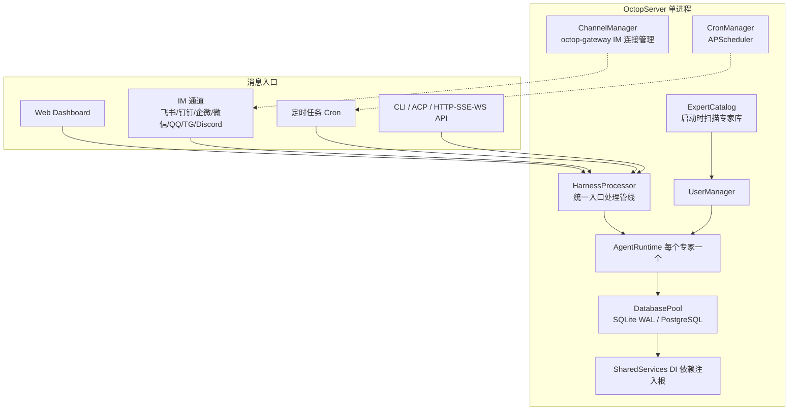
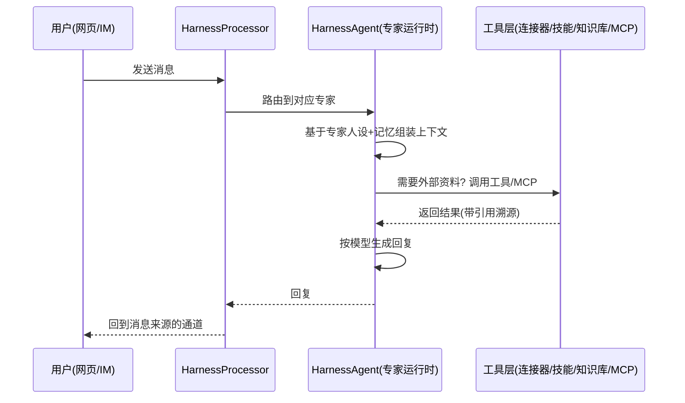

# Octop 研究笔记

> 仓库地址：https://github.com/TencentCloud/Octop
> 研究日期：2026-11-17 | 版本参考：v1.0.3b6（2026-11-15 最新提交）

## 一、项目定位

Octop 是腾讯云开源的**自托管（self-hosted）多用户多智能体 AI 助手平台**，社区常称之为"开源版 WorkBuddy"。一句话概括：

> 一个进程跑在你自己的机器/NAS/服务器上，把 Web 控制台、CLI、IM 接入（飞书、钉钉、企微、微信、QQ、Telegram、Discord）、定时任务全部打包，所有数据落在本地 `~/.octop/` 目录，主打"数据不出门"。

与 WorkBuddy 的关系：功能形态高度相似（专家、技能、连接器、知识库、定时任务），但 WorkBuddy 是开箱即用的闭源成品（模型算力在云上），Octop 面向个人/家庭/小团队，强调自部署、自接模型（云端 API 或本地 Ollama 皆可），MIT 协议。

## 二、技术栈

| 层 | 技术 |
|---|---|
| 语言 | Python 3.12+ |
| Web 框架 | FastAPI + uvicorn |
| Agent 运行时 | Octop Harness（自研） |
| IM 网关 | Octop Gateway（多平台通道桥接） |
| 记忆系统 | Octop Memory（分层召回 + 全文检索） |
| 浏览器自动化 | Octop Browser（CDP，持久化 profile） |
| 控制面数据库 | SQLite（WAL，默认）/ PostgreSQL（可选） |
| 前端 | React 18 + TypeScript + Vite + Ant Design |
| 调度 | APScheduler |
| 工程化 | hatchling · ruff · mypy · pytest |

## 三、核心架构

最大的设计亮点是**单进程模型**：没有外部消息队列，没有 Redis，Web UI / IM / cron 全部经由进程内的 `HarnessProcessor` 汇入同一条处理管线，重启后从控制面数据库完整重建状态。



时序上，一句话从进入到回复的路径：



官方架构树：

```
OctopServer
 ├─ DatabasePool            SQLite (WAL) or PostgreSQL
 ├─ SharedServices          DI root — 每个仓库 + 配置
 ├─ ExpertCatalog           启动时扫描 agents/experts/library/
 ├─ UserManager
 │   └─ HarnessAgentManager (每用户)
 │       └─ AgentRuntime (每专家)
 │           ├─ HarnessAgent      Agent 运行时 (octop-harness)
 │           ├─ HarnessProcessor  IM/UI/cron 入口
 │           ├─ ChannelManager    IM 连接 (octop-gateway)
 │           └─ CronManager       APScheduler
 └─ FastAPI app (uvicorn)
```

## 四、核心功能模块

### 1. 专家（Experts）体系
- 每用户可创建多个专家，每个专家有**独立的工作区、模型供应商、通道、定时任务**——文件和记忆互相隔离
- 16 种 MBTI 人格模板 + 自定义 system prompt
- 内置专家库（`infra/agents/experts/library/`，启动时扫描）+ 专家市场
- 专家可在同一部署内共享/发布
- **AgentTeams（Beta）**：协调者调度多个成员专家完成多步任务

### 2. 连接器（Connectors）
- OAuth 应用 + MCP 网关两种扩展方式
- 内置腾讯系连接器：腾讯文档、腾讯会议、IMA、腾讯新闻、微信读书、微云、QQ音乐等 18 个
- 第三方：Notion、飞书、企业微信 CLI 等

### 3. 技能（Skills）与插件（Plugins）
- 兼容 OpenClaw 式技能目录（SKILL.md 文件夹/zip 安装）
- 技能市场（SkillHub 协议，`SKILL_MARKET_ORIGIN`）；无法访问公网时可自建私有市场
- 插件系统：第三方插件可安装/启停/配置，内置插件按需开启

### 4. 记忆与知识库
- **Octop Memory**：分层召回 + 全文检索，记忆随工作区迁移
- **知识库**：文档 RAG，回答带引用溯源；语料可在部署内共享
- 使用 PostgreSQL 时 Agent 记忆默认复用同一 DSN（按专家分 schema）

### 5. 开发者能力
- **ACP 双向**：`octop acp --agent main` 把专家暴露给 Zed/OpenCode/Claude Code 等 IDE；也可在 Web 里把任务委托给 OpenCode/Claude Code（带权限门控）
- **终端 AI+**：浏览器里的交互式 Shell，AI 辅助执行命令与排障
- **Browser AI+**：CDP 无头浏览器，网页自动化、截图
- **远程桌面**：控制台直接操作 Linux/Windows/macOS 桌面

## 五、数据目录（一切都在 ~/.octop/）

```
~/.octop/
├── config.json               # 进程配置（可选 database 段）
├── octop.db                  # SQLite：用户、专家、通道、定时任务
├── secrets/                  # JWT 密钥、通道 token
├── agents/<agent_id>/        # 每专家工作区（SOUL.md、技能…）
├── security/tool_guard/      # shell 命令 allow/deny 规则
├── logs/                     # 运行日志
├── venv/                     # uv 管理的 Python（安装器布局）
└── bin/octop                 # PATH 包装器
```

专家的文件后端可插拔：本地磁盘 / Docker 沙箱 / PostgreSQL / COS/S3——与控制面数据库是分开的两套存储。

## 六、部署速记

个人电脑（Windows PowerShell）：
```powershell
irm https://finnie-1258344699.cos.ap-guangzhou.myqcloud.com/octop/install.ps1 | iex
octop init
octop run
```

服务器/NAS（Docker，走南京大学镜像加速）：
```bash
docker run -d --name octop -p 8088:8088 \
  -v octop-data:/data/.octop -e HOME=/data \
  -e OCTOP_ADMIN_USERNAME=admin \
  -e OCTOP_DEFAULT_PASSWORD='改成你自己的强密码' \
  ghcr.nju.edu.cn/tencentcloud/octop:latest
```

装完访问 http://127.0.0.1:8088 ，在「管理 → 模型」里接模型（腾讯云/OpenAI/DeepSeek/Ollama 预设）。密钥可写入 `~/.octop/env`。迁移用 `octop backup`。

**已知踩坑**（社区反馈）：PyPI v1.0.1 包缺 `bundled` 目录，`octop init` 会报 `ModuleNotFoundError`，需从 GitHub 手动补目录；`init --force` 会连带删掉已安装内容，慎用。

## 七、安全设计

- JWT 多用户隔离（一管理员，全家/全组共用一个实例）
- 工具审批门控：敏感操作先停下等用户点头
- Shell 命令护栏（`security/tool_guard` 的 allow/deny 规则）
- PII 脱敏
- 默认 API 文档关闭，需在 config.json 显式开启

## 八、Roadmap（值得关注的演进方向）

- **进行中**：AgentTeams（多专家编排）、移动端（内测）
- **规划中**：
  - 自我进化——从日常对话自动蒸馏出可复用技能
  - 浏览器技能"录制回放"（把操作录成技能）
  - Managed Agents——平台托管 Agent 生命周期
  - Project——以项目为单位聚合专家/文件/会话
  - 云边协同——本地跑轻任务，重活卸载到云端
  - 插件市场、会话式控制面（聊天直接建专家/配通道）

## 九、对我的学习价值

1. **单进程 + 控制面数据库重建状态**的设计，是"家庭级自部署"复杂度上限的漂亮解法——不需要 K8s 也能重启安全
2. **专家 = 工作区 + 人设 + 记忆 + 供应商 + 通道 + cron 的完整封装**，这个抽象值得借鉴到任何多 Agent 项目
3. Harness / Gateway / Memory / Browser 四个运行时组件拆分清晰，读源码时按这四条线走
4. 与 WorkBuddy 互通验证了"技能目录（SKILL.md）"正在成为 Agent 生态的事实标准（OpenClaw / WorkBuddy / Octop 三方互认）
